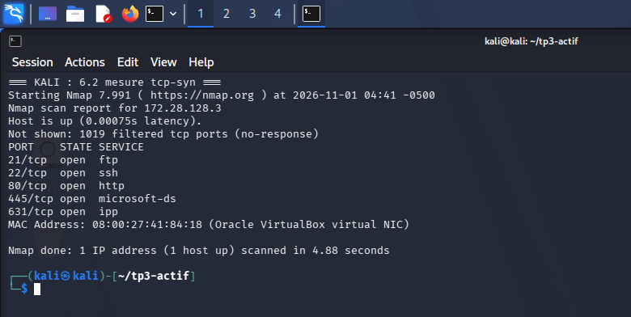
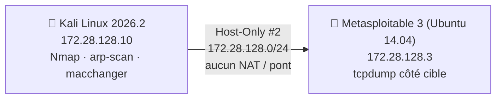

# 🔍 TP3 — Reconnaissance active, scan et traçabilité (Nmap)


> **EN —** Active reconnaissance of a Metasploitable 3 VM from Kali Linux in an isolated Host-Only lab: MAC randomisation and what it does (and does not) hide, host discovery (Nmap, arp-scan, netdiscover), TCP Connect vs SYN, UDP, service/OS detection, NSE scripts — and a **packet-level measurement of the traces each technique leaves** on the target (`tcpdump`). 51 terminal screenshots, full report.

Travaux pratiques du module **Ethical Hacking** — EMSI, 3ᵉ année du cycle ingénieur (5IIR).

<p align="center"></p>
<p align="center"><sub>Un scan SYN, parfois dit « discret », est mesuré : il produit autant de paquets qu'un scan TCP Connect.</sub></p>

## 🎯 Ce que démontre ce projet

| Compétence | Preuve dans le dépôt |
|---|---|
| Distinction **identité locale (MAC) / identité réseau (IP)** | Randomisation de la MAC avec `macchanger`, observée côté cible avec `tcpdump -e` et `arp -n` ; l'IP reste visible |
| **Découverte d'hôtes** | `nmap -sn`, `arp-scan`, `netdiscover` : cible trouvée en 172.28.128.3 |
| Scan de ports **TCP / UDP** | TCP Connect vs SYN, UDP ciblé, interprétation de `open`, `closed`, `filtered` |
| Détection de **services, versions et OS** | `-sV`, `-O` : 7 services ouverts (FTP, SSH, HTTP, SMB, CUPS, MySQL, Jetty), versions anciennes relevées |
| **NSE** responsable | Scripts `default` et `safe` seulement ; aucun script intrusif |
| **Mesure de la détectabilité** | Captures `tcpdump` de la cible pour 6 techniques, nombre de paquets comparé |
| Raisonnement défensif | Pourquoi un VPN ou une usurpation d'IP n'offre pas d'anonymat absolu ; approche d'un pentest professionnel |

## 🧪 Résultats clés

| Mesure | Résultat |
|---|---|
| Hôte actif découvert | `172.28.128.3` (Metasploitable 3, Ubuntu 14.04) |
| Services ouverts | FTP 21, SSH 22, HTTP 80, SMB 445, CUPS, MySQL 3306, Jetty |
| Scan SYN vs TCP Connect | **≈ 2 000 paquets chacun** pour 1 024 ports : le SYN n'est pas plus discret |
| Scripts NSE `safe` | **> 36 000 paquets** en plus de six minutes : le plus bruyant |
| Changer la MAC | Masque l'identité de couche 2 locale, **pas** l'adresse IP |

> 💡 **Enseignement clé :** aucune technique de scan n'est invisible. Un pentest professionnel se fait depuis une machine et une adresse IP dédiées, autorisées et journalisées : **la traçabilité est contrôlée, pas supprimée**.

## 🏗️ Architecture du laboratoire



Réseau Host-Only exclusif (jamais de NAT ni de pont pendant le TP), snapshots avant chaque phase.

## 📚 Les parties du TP

Le guide complet — **objectif, commande exacte, capture, observation et analyse pour chaque exercice** — est dans **[`docs/walkthrough.md`](docs/walkthrough.md)**.

| Partie | Contenu |
|---|---|
| 1 | Laboratoire et identité initiale : vérification du réseau isolé, connectivité |
| 2 | Adresse MAC et traçabilité locale : traces sur la cible, randomisation, restauration |
| 3 | Découverte des hôtes actifs : Nmap, ARP |
| 4 | Scan des ports TCP : ports courants, Connect et SYN, interprétation des états |
| 5 | UDP, services et système : UDP ciblé, `-sV`, estimation de l'OS |
| 6 | Scripts NSE et détectabilité : `default`, `safe`, mesure des traces par technique |
| 7 | Analyse de la traçabilité, difficultés rencontrées, limites |

📄 **Rapport complet (PDF)** : [`report/TP3_Rapport_Ethical_Hacking.pdf`](report/TP3_Rapport_Ethical_Hacking.pdf)

## 📁 Structure

```
├── README.md
├── docs/walkthrough.md      # guide pas-à-pas détaillé (51 captures)
├── assets/                  # captures de terminal
├── report/                  # rapport PDF
└── automation/vm.ps1        # saisie de commandes et capture d'écran des VM via VBoxManage
```

## ⚖️ Cadre éthique

Tout a été réalisé sur **deux machines virtuelles du laboratoire**, en réseau Host-Only isolé, sans aucun scan hors laboratoire. Ne reproduisez ces techniques que sur des systèmes dont vous avez l'autorisation écrite.

## 👤 Auteur

**Omar Babba** — élève ingénieur en Ingénierie Informatique et Réseaux, EMSI (3ᵉ année, 5IIR), orienté cybersécurité.

Autres travaux de la série : [TP4 — Énumération Windows et évasion contrôlée](https://github.com/omarbabba779xx/ethical-hacking-tp4-windows-enumeration-evasion) · [TP5 — Analyse de vulnérabilités](https://github.com/omarbabba779xx/ethical-hacking-tp5-vulnerability-analysis-nmap-nse)

## 📄 Licence

[MIT](LICENSE)
