## 1. Introduction et objectifs

Ce rapport documente la réalisation du **TP 3 « Reconnaissance active, scan et traçabilité »** du module
**Ethical Hacking**. À partir d'une machine **Kali Linux**, l'objectif est de découvrir une machine
**Metasploitable 3** dans un réseau virtuel isolé, d'analyser ses ports et ses services, puis d'observer les traces
que ces opérations laissent sur la cible. Le TP étudie aussi la différence entre l'adresse IP et l'adresse MAC.

Chaque étape du rapport donne : l'objectif, la commande exécutée, la capture d'écran du terminal correspondant,
ce qui est observé et l'analyse. Les 50 captures prises pendant la réalisation sont toutes intégrées.

| Partie | Contenu | Résultat attendu |
|---|---|---|
| 1 | Laboratoire et identité initiale | IP, MAC, interfaces et routes des deux machines |
| 2 | Adresse MAC et traçabilité locale | Observer la MAC avant, après randomisation et après restauration |
| 3 | Découverte des hôtes actifs | Nmap, ARP-Scan et Netdiscover comparés |
| 4 | Scan des ports TCP | TCP Connect et TCP SYN comparés, états des ports |
| 5 | UDP, services et système | Versions des services, estimation de l'OS |
| 6 | NSE et détectabilité | Scripts sûrs, mesure des traces de chaque technique |

> ⚠️ **Cadre éthique et légal**
>
> Toutes les manipulations sont limitées aux machines virtuelles du laboratoire. Le réseau est en mode **Host-Only**, sans accès Internet. Aucun scan d'Internet, du réseau de l'établissement ou d'une machine tierce n'a été effectué. Les catégories NSE `brute`, `exploit` et `dos` n'ont pas été utilisées.

## 2. Environnement et architecture du laboratoire

Le laboratoire repose sur **VirtualBox 7.2.8** (hôte Windows 11). Deux machines virtuelles sont reliées par le
réseau **Host-Only #2** (172.28.128.0/24), sans serveur DHCP et sans passerelle. Aucune carte NAT ou pont n'est attachée.

| Rôle | Machine | Système | Configuration |
|---|---|---|---|
| Machine de pentest | kali-linux-2026.2-virtualbox-amd64 | Kali Linux 2026.2 (noyau 6.19) | 2 Go de RAM, 2 vCPU, une carte Host-Only #2 |
| Cible autorisée | Metasploitable3-ub1404 | Ubuntu 14.04 LTS (noyau 3.13) | 2 Go de RAM, 2 vCPU, une carte Host-Only #2 |

#### Mesures de sécurité prises avant le TP

- **Aucune carte NAT ni pont** : la carte NAT par défaut a été retirée des deux machines ; seule la carte Host-Only reste.
Elle n'a été rebranchée temporairement sur Kali que pour installer les outils, puis retirée avant tout scan.

- **Snapshots** : un snapshot « avant-TP3 » a été pris sur chaque machine, un snapshot « TP3-pret » sur Kali une fois les outils installés.

- **Outils installés sur Kali** : `nmap`, `arp-scan`, `netdiscover`, `macchanger`, `tcpdump`, `wireshark`.

- **Arborescence de travail** : `~/tp3-actif/{identite,decouverte,tcp,udp,services,nse,traces,rapport}` et un journal horodaté.

- **Adresses IP** : Kali en IP fixe permanente (profil NetworkManager `lab-hostonly`), Metasploitable en IP posée à la main (`ip addr add`) car le réseau n'a pas de DHCP.

```bash
sudo apt update
sudo apt install nmap arp-scan netdiscover macchanger tcpdump wireshark -y
mkdir -p ~/tp3-actif/{identite,decouverte,tcp,udp,services,nse,traces,rapport}
cd ~/tp3-actif
date -Iseconds | tee rapport/journal.txt
```

> ℹ️ **Identifiants de la cible**
>
> Le compte par défaut de cette image Metasploitable 3 (Ubuntu 14.04) est `vagrant`. La commande `ip -br` n'existe pas sur cette ancienne version : les commandes équivalentes du sujet sont `ip addr` et `ip link`.

## 3. Méthodologie de réalisation et de capture

Les commandes sont les mêmes que celles du sujet. Pour garantir des captures homogènes, elles ont été saisies dans les
terminaux des deux machines depuis l'hôte avec l'outil `VBoxManage` (saisie clavier à distance) et l'écran de
chaque machine a été capturé juste après (`VBoxManage controlvm … screenshotpng`). Les mots de passe `sudo`
ont été saisis par l'étudiant. Chaque capture montre uniquement le terminal.

| Écart avec le sujet | Raison | Effet |
|---|---|---|
| `-n` ajouté aux commandes `nmap` | Nmap 7.991 plante (`massdns.cc: Assertion failed`) quand aucun serveur DNS n'est joignable, ce qui est normal sans Internet. | Pas de résolution DNS inverse ; aucun effet sur les résultats des scans. |
| `ip link set eth0 promisc on` après `macchanger -r` | Après un changement de MAC, la carte virtuelle VirtualBox ne reçoit plus les trames destinées à la nouvelle MAC (voir 5.2). | Le ping fonctionne avec la MAC aléatoire ; la politique « Allow All » est aussi activée sur les cartes. |
| Un fichier `.pcap` par technique (6.2) | Permet de comparer le volume de paquets de chaque technique (Table 8). | Commande identique à celle du sujet, avec un nom de fichier différent. |

## 4. Partie 1 — Laboratoire et identité initiale

### 4.1. Exercice 1.1 : vérification du réseau isolé

### 🔹 Étape 1 — Relever l'identité réseau de Kali

*Objectif : connaître l'IP, la MAC, les routes et les voisins de la machine de pentest.*

```bash
ip -br address
ip route
ip neigh
```

<p align="center">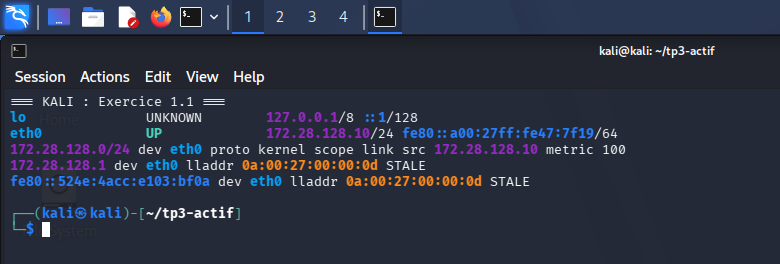</p>
<p align="center"><sub><b>Figure 1</b> — Identité réseau de Kali : <code>eth0</code> en 172.28.128.10/24, une seule route, voisins ARP.</sub></p>

**Observation.** `eth0` est UP avec l'adresse **172.28.128.10/24** (adresse IPv6 de lien `fe80::a00:27ff:fe47:7f19`,
construite à partir de la MAC). La table de routage contient une seule route : `172.28.128.0/24 dev eth0 proto kernel scope link src 172.28.128.10`.
La table de voisinage connaît `172.28.128.1` (MAC `0a:00:27:00:00:0d`, l'adaptateur Host-Only de l'hôte Windows).

### 🔹 Étape 2 — Relever l'identité réseau de Metasploitable 3

*Objectif : obtenir les mêmes informations côté cible (version Linux : `ip addr`, `ip link`, `route -n`, `arp -n`).*

```bash
ip addr show eth0
ip link show eth0
route -n
arp -n
```

<p align="center">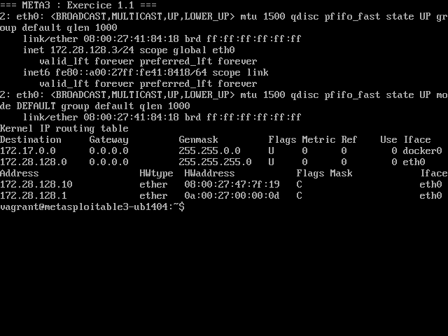</p>
<p align="center"><sub><b>Figure 2</b> — Identité réseau de Metasploitable 3 : <code>eth0</code> 172.28.128.3/24, table de routage et table ARP.</sub></p>

**Observation.** `eth0` porte **172.28.128.3/24** avec la MAC `08:00:27:41:84:18`. La table de routage ne contient que
`172.17.0.0/16` (interface Docker `docker0`) et `172.28.128.0/24` (`eth0`). La table ARP contient Kali
(`172.28.128.10` → `08:00:27:47:7f:19`) et l'hôte (`172.28.128.1`).

| Machine | Interface | Adresse IP | Adresse MAC |
|---|---|---|---|
| Kali Linux | eth0 | 172.28.128.10/24 | 08:00:27:47:7f:19 |
| Metasploitable 3 | eth0 | 172.28.128.3/24 | 08:00:27:41:84:18 |

<p class="tcap">**Table 3** — Identités réseau initiales</p>

> 🔎 **Analyse — questions du TP**
>
> - **Même sous-réseau ?** Oui : 172.28.128.0/24 (masque 255.255.255.0) pour les deux. Elles se joignent directement, sans routeur.
>
> - **Route par défaut vers Internet ?** Non. Ni Kali ni Metasploitable n'ont de ligne `default` (`0.0.0.0` en destination).
>
> - **Pourquoi l'absence d'Internet est-elle importante ?** Metasploitable 3 est volontairement vulnérable : l'isoler évite qu'elle soit attaquée
> depuis l'extérieur ou utilisée comme relais, et évite tout scan accidentel d'une machine tierce, interdit par le sujet.

### 4.2. Exercice 1.2 : test de connectivité

### 🔹 Étape 3 — Tester la liaison et mémoriser les voisins

*Objectif : vérifier que Kali joint la cible et associe son IP à sa MAC, en conservant les preuves.*

```bash
ping -c 4 172.28.128.3 | tee identite/ping-initial.txt
ip neigh | tee identite/voisins-initiaux.txt
```

<p align="center">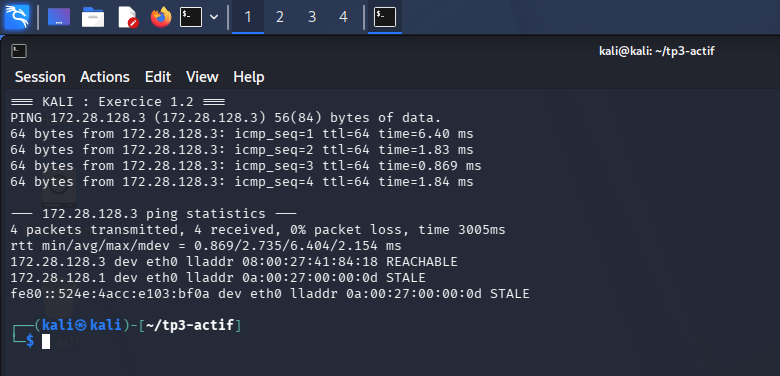</p>
<p align="center"><sub><b>Figure 3</b> — Ping de Kali vers la cible puis table de voisinage ; les sorties sont enregistrées dans <code>identite/</code>.</sub></p>

**Observation.** 4 paquets transmis, 4 reçus, **0 % de perte**, temps aller-retour moyen 2,7 ms (min 0,869 ms, max 6,40 ms).
Après le ping, `172.28.128.3` apparaît dans la table de voisinage avec la MAC `08:00:27:41:84:18` à l'état `REACHABLE`.

> 🔎 **Analyse**
>
> Le résultat attendu est atteint : Kali reçoit des réponses et associe l'IP cible à une adresse MAC. Ce mécanisme (ARP) fonctionne uniquement sur le segment local.

## 5. Partie 2 — Adresse MAC et traçabilité locale

### 5.1. Exercice 2.1 : observer les traces sur la cible

### 🔹 Étape 4 — Lancer la capture sur la cible

*Objectif : voir ce que la cible enregistre quand Kali la contacte.*

Sur Metasploitable 3 la capture est lancée, puis Kali génère quelques paquets :

```bash
# Metasploitable 3
sudo tcpdump -n -e -i eth0

# Kali
ping -c 3 172.28.128.3
```

<p align="center">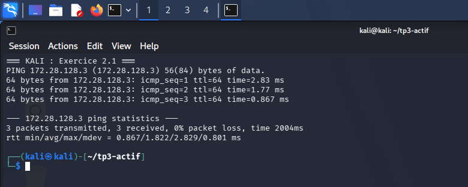</p>
<p align="center"><sub><b>Figure 4</b> — Kali envoie 3 pings vers la cible.</sub></p>

<p align="center">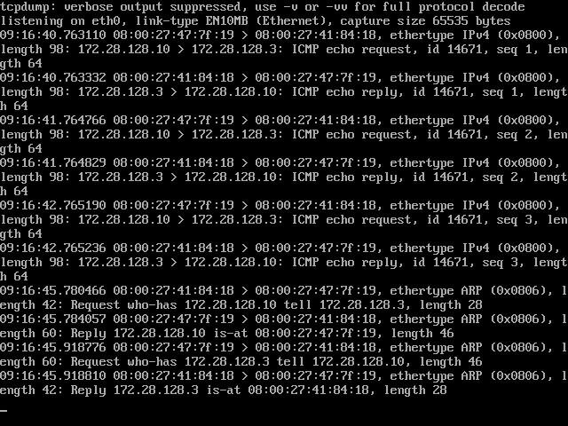</p>
<p align="center"><sub><b>Figure 5</b> — Capture <code>tcpdump -n -e</code> sur la cible : MAC et IP source de Kali.</sub></p>

**Observation.** Chaque ligne `tcpdump -e` affiche les adresses MAC puis les adresses IP. On lit
`08:00:27:47:7f:19 > 08:00:27:41:84:18, IPv4 … 172.28.128.10 > 172.28.128.3: ICMP echo request` (seq 1 à 3) suivi des
`echo reply` de la cible. Quelques secondes plus tard, des échanges **ARP** apparaissent (`who-has 172.28.128.10 tell 172.28.128.3`
puis `is-at 08:00:27:47:7f:19`, et l'inverse). Une requête **BOOTP/DHCP** de la cible (`0.0.0.0:68 > 255.255.255.255:67`) est du bruit de fond : elle cherche une IP sans serveur DHCP.

> ℹ️ **Résultat à retenir**
>
> Source de Kali vue par la cible : **IP 172.28.128.10** et **MAC 08:00:27:47:7f:19**.

### 5.2. Exercice 2.2 : randomisation contrôlée de la MAC

### 🔹 Étape 5 — Randomiser la MAC de Kali

*Objectif : changer l'identité de couche 2 de Kali et observer l'effet côté cible. La MAC initiale est notée avant toute modification.*

```bash
ip link show eth0 | tee identite/mac-avant.txt

sudo ip link set eth0 down
sudo macchanger -r eth0
sudo ip link set eth0 up

ip link show eth0 | tee identite/mac-apres.txt
macchanger -s eth0
```

<p align="center">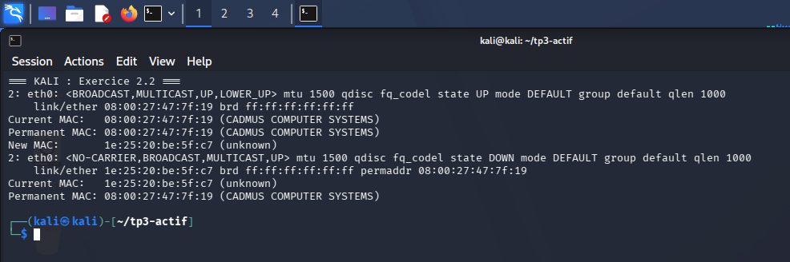</p>
<p align="center"><sub><b>Figure 6</b> — Randomisation avec <code>macchanger -r</code> : la MAC passe de 08:00:27:47:7f:19 à 1e:25:20:be:5f:c7.</sub></p>

**Observation.** `macchanger` indique **Current MAC 08:00:27:47:7f:19** (constructeur : CADMUS COMPUTER SYSTEMS, l'OUI de VirtualBox)
puis **New MAC 1e:25:20:be:5f:c7** (« unknown », aucun constructeur). La **Permanent MAC** reste `08:00:27:47:7f:19`.
La capture `mac-apres.txt` a été prise juste après `ip link set eth0 up` : l'interface n'avait pas encore de porteuse
(`NO-CARRIER`), ce qui est normal.

### 🔹 Étape 6 — Renouveler le test de connectivité

*Objectif : observer `tcpdump` et `arp -n` sur la cible avec la nouvelle MAC.*

```bash
# Kali
sudo nmcli connection up lab-hostonly
ping -c 3 172.28.128.3
```

<p align="center">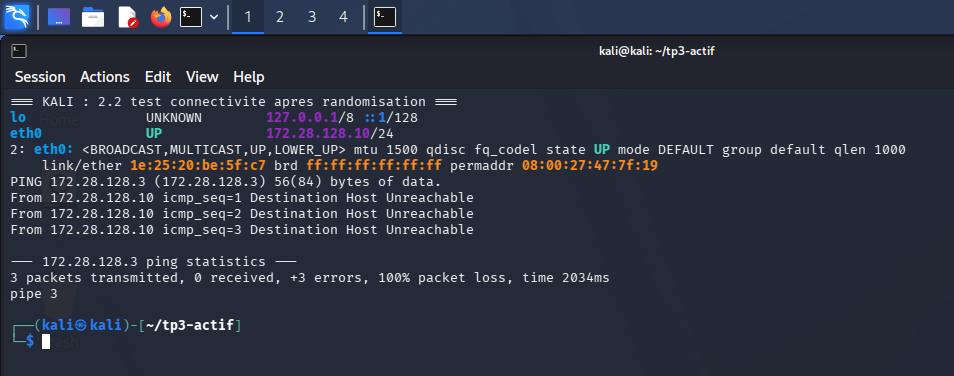</p>
<p align="center"><sub><b>Figure 7</b> — Premier essai après randomisation : le ping échoue (<code>Destination Host Unreachable</code>) alors que l'IP est bien en place.</sub></p>

<p align="center">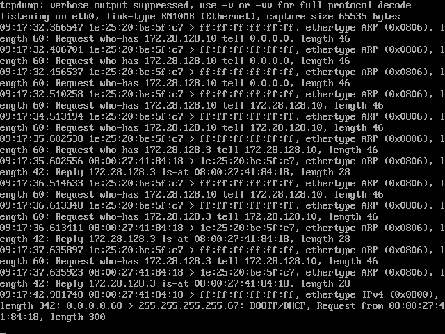</p>
<p align="center"><sub><b>Figure 8</b> — Sur la cible : les requêtes ARP de Kali portent déjà la nouvelle MAC <code>1e:25:20:be:5f:c7</code> et la cible répond.</sub></p>

**Observation.** Côté cible, `tcpdump` montre bien `1e:25:20:be:5f:c7 > ff:ff:ff:ff:ff:ff … Request who-has 172.28.128.10`, puis
`who-has 172.28.128.3 tell 172.28.128.10` et la réponse `Reply 172.28.128.3 is-at 08:00:27:41:84:18` adressée à la **nouvelle MAC**.
Pourtant Kali ne reçoit pas la réponse et le ping échoue : c'est une particularité de VirtualBox.

> ⚠️ **Diagnostic de l'échec**
>
> La carte virtuelle `82540EM` de VirtualBox filtre les trames destinées à une MAC différente de celle déclarée dans la configuration de la VM.
> Un `tcpdump` lancé sur Kali (qui met l'interface en mode promiscuité) a fait réapparaître les réponses ARP et le ping a alors réussi, ce qui a localisé le problème.
> Solution retenue : activer le mode promiscuité sur l'interface de Kali (`sudo ip link set eth0 promisc on`) et la politique « Allow All » sur les cartes Host-Only.

```bash
sudo ip link set eth0 promisc on
sudo ip neigh flush dev eth0
ip link show eth0
ping -c 3 172.28.128.3
```

<p align="center">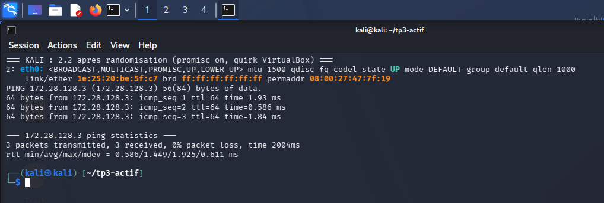</p>
<p align="center"><sub><b>Figure 9</b> — Avec le mode promiscuité : la MAC est <code>1e:25:20:be:5f:c7</code> (permaddr 08:00:27:47:7f:19) et le ping réussit, 3/3.</sub></p>

<p align="center">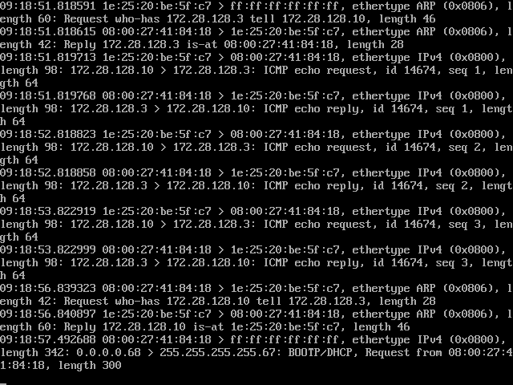</p>
<p align="center"><sub><b>Figure 10</b> — Capture de la cible pendant le test avec la MAC aléatoire.</sub></p>

<p align="center">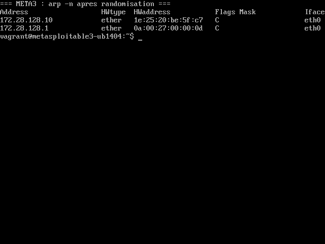</p>
<p align="center"><sub><b>Figure 11</b> — Table ARP de la cible : <code>172.28.128.10</code> est maintenant associée à <code>1e:25:20:be:5f:c7</code>.</sub></p>

> 🔎 **Analyse — questions du TP**
>
> - **Quelle MAC est maintenant visible depuis la cible ?** La nouvelle MAC aléatoire `1e:25:20:be:5f:c7`, dans `tcpdump` comme dans `arp -n`.
>
> - **L'adresse IP de Kali a-t-elle changé ?** Non, elle reste `172.28.128.10`.
>
> - **Un serveur derrière un routeur pourrait-il voir cette MAC ?** Non. La MAC n'existe qu'à la couche 2 du segment local : à chaque routeur traversé elle est remplacée par celle du routeur. Seule l'IP circule de bout en bout.

### 5.3. Exercice 2.3 : restaurer l'adresse MAC permanente

### 🔹 Étape 7 — Restaurer la MAC d'origine

*Objectif : revenir à l'identité initiale et le prouver.*

```bash
sudo ip link set eth0 down
sudo macchanger -p eth0
sudo ip link set eth0 up
macchanger -s eth0
sudo ip link set eth0 promisc off
sudo nmcli connection up lab-hostonly
ip -br address
ping -c 2 172.28.128.3
```

<p align="center">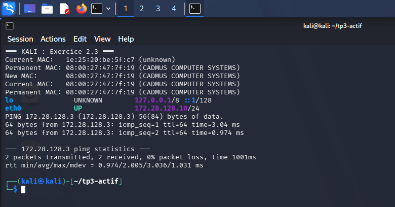</p>
<p align="center"><sub><b>Figure 12</b> — MAC restaurée : <code>New MAC 08:00:27:47:7f:19</code> ; IP revenue et ping 2/2.</sub></p>

**Observation.** `macchanger -p` remet la MAC permanente : **Current MAC 08:00:27:47:7f:19 (CADMUS COMPUTER SYSTEMS)**.
Le mode promiscuité est désactivé, l'IP `172.28.128.10/24` est de retour et le ping vers la cible répond (2/2).

| Étape | MAC de eth0 (Kali) | IP de Kali |
|---|---|---|
| Avant | 08:00:27:47:7f:19 (CADMUS, OUI VirtualBox) | 172.28.128.10 |
| Après `macchanger -r` | 1e:25:20:be:5f:c7 (aléatoire) | 172.28.128.10 |
| Après `macchanger -p` | 08:00:27:47:7f:19 (restaurée) | 172.28.128.10 |

> 🔎 **Conclusion de la partie 2**
>
> La MAC est une identité locale de couche 2 que l'on peut modifier, tandis que l'adresse IP reste l'identité principalement observée lors d'une communication distante.

## 6. Partie 3 — Découverte des hôtes actifs

### 6.1. Exercice 3.1 : découverte avec Nmap

### 🔹 Étape 8 — Balayage ping de tout le réseau

*Objectif : lister les hôtes actifs du /24 sans scanner de ports (`-sn`).*

```bash
nmap -sn -n 172.28.128.0/24 -oN decouverte/nmap-ping-sweep.txt
```

<p align="center">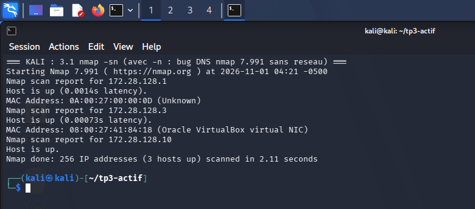</p>
<p align="center"><sub><b>Figure 13</b> — Balayage ping Nmap : 256 adresses examinées, 3 hôtes actifs en 2,11 s.</sub></p>

**Observation.** Trois hôtes répondent : `172.28.128.1` (MAC 0A:00:27:00:00:0D, constructeur inconnu, latence 1,4 ms),
`172.28.128.3` (MAC 08:00:27:41:84:18, « Oracle VirtualBox virtual NIC », latence 0,73 ms) et `172.28.128.10` (Kali elle-même, sans MAC car locale).

> ⚠️ **Première exécution : bug DNS de Nmap**
>
> La commande exacte du sujet (`nmap -sn 172.28.128.0/24`) a provoqué le plantage `nmap: massdns.cc:763: Assertion 'new_reqs.empty()' failed` suivi de `zsh: IOT instruction`. Nmap tente la résolution DNS inverse de chaque hôte alors qu'aucun serveur DNS n'est joignable. L'option `-n` (pas de résolution DNS) contourne le problème sans modifier le résultat. Elle a été ajoutée à toutes les commandes `nmap` suivantes.

### 6.2. Exercice 3.2 : découverte ARP

### 🔹 Étape 9 — ARP-Scan

*Objectif : interroger le segment local par ARP, couche 2.*

```bash
sudo arp-scan --interface=eth0 --localnet | tee decouverte/arp-scan.txt
```

<p align="center">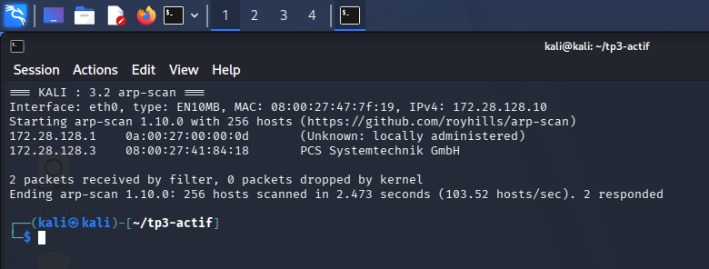</p>
<p align="center"><sub><b>Figure 14</b> — ARP-Scan : 256 hôtes examinés en 2,47 s, 2 réponses.</sub></p>

**Observation.** ARP-Scan (interface `eth0`, MAC `08:00:27:47:7f:19`, IPv4 `172.28.128.10`) reçoit 2 réponses : `172.28.128.1` (« locally administered ») et `172.28.128.3` (08:00:27:41:84:18, **PCS Systemtechnik GmbH**, le fabricant de l'OUI VirtualBox).

### 🔹 Étape 10 — Netdiscover

*Objectif : obtenir la même information avec un second outil ARP.*

```bash
sudo netdiscover -i eth0 -r 172.28.128.0/24 -P | tee decouverte/netdiscover.txt
```

<p align="center">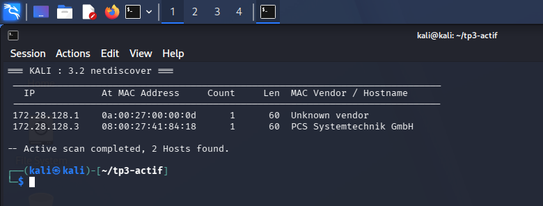</p>
<p align="center"><sub><b>Figure 15</b> — Netdiscover en mode actif : 2 hôtes trouvés.</sub></p>

**Observation.** Netdiscover liste les mêmes deux hôtes avec leurs MAC et fabricants (« Unknown vendor » pour .1 et « PCS Systemtechnik GmbH » pour .3).

#### Hôtes découverts

| Adresse IP | Adresse MAC | Fabricant | Outils concordants |
|---|---|---|---|
| 172.28.128.3 | 08:00:27:41:84:18 | PCS Systemtechnik (VirtualBox) | Nmap, ARP-Scan, Netdiscover |
| 172.28.128.1 | 0a:00:27:00:00:0d | inconnu (adaptateur Host-Only de l'hôte Windows) | Nmap, ARP-Scan, Netdiscover |
| 172.28.128.10 | 08:00:27:47:7f:19 | Kali (la machine qui scanne) | Nmap seulement |

<p class="tcap">**Table 4** — Hôtes découverts dans le laboratoire</p>

> 🔎 **Analyse — questions du TP**
>
> - **Pourquoi ARP est-il efficace sur un réseau local ?** ARP fonctionne en couche 2 par diffusion : une machine du même segment doit y répondre pour communiquer, et il ne dépend ni d'un pare-feu IP ni d'ICMP.
>
> - **Pourquoi une machine peut-elle être active sans répondre à ICMP ?** Un pare-feu peut filtrer l'ICMP tout en laissant passer d'autres protocoles. Ici plusieurs ports TCP sont `filtered` alors que la machine répond à ARP.
>
> - **Quelle méthode a fourni le plus d'informations ?** ARP-Scan et Netdiscover donnent MAC et fabricant en une passe ; Nmap `-sn` donne en plus la latence et reconnaît la carte VirtualBox.

## 7. Partie 4 — Scan des ports TCP

### 7.1. Exercice 4.1 : scan des ports courants

### 🔹 Étape 11 — Scan des 1000 ports les plus courants

*Objectif : première cartographie des services de la cible.*

```bash
nmap -n 172.28.128.3 -oN tcp/ports-courants.txt
```

<p align="center">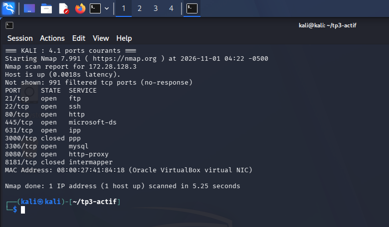</p>
<p align="center"><sub><b>Figure 16</b> — Scan des ports courants : 991 ports filtrés, 9 ports affichés, durée 5,25 s.</sub></p>

**Observation.** Ports **open** : 21 (ftp), 22 (ssh), 80 (http), 445 (microsoft-ds), 631 (ipp), 3306 (mysql), 8080 (http-proxy).
Ports **closed** : 3000 (ppp) et 8181 (intermapper). Les 991 autres ports sont **filtered** (aucune réponse).

### 🔹 Étape 12 — Scan des ports ciblés

*Objectif : vérifier les ports demandés par le sujet.*

```bash
nmap -n -p 21,22,23,25,80,139,445,3306,5432,8180 172.28.128.3 -oN tcp/ports-cibles.txt
```

<p align="center">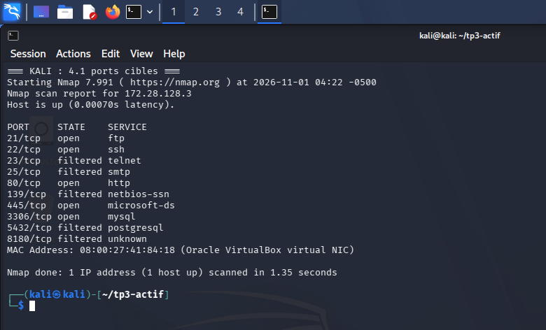</p>
<p align="center"><sub><b>Figure 17</b> — Scan des 10 ports ciblés en 1,35 s.</sub></p>

| Port | État | Service supposé | Observation |
|---|---|---|---|
| 21 | open | ftp | Service de transfert de fichiers accessible |
| 22 | open | ssh | Accès distant sécurisé |
| 23 | filtered | telnet | Aucune réponse : filtrage |
| 25 | filtered | smtp | Aucune réponse : filtrage |
| 80 | open | http | Serveur web |
| 139 | filtered | netbios-ssn | Aucune réponse, alors que 445 est ouvert |
| 445 | open | microsoft-ds | Partage de fichiers SMB |
| 3306 | open | mysql | Base de données exposée sur le réseau |
| 5432 | filtered | postgresql | Aucune réponse : filtrage |
| 8180 | filtered | inconnu | Aucune réponse : filtrage |

<p class="tcap">**Table 5** — Première analyse des ports TCP</p>

### 7.2. Exercice 4.2 : TCP Connect et TCP SYN

### 🔹 Étape 13 — Scan TCP Connect (`-sT`)

*Objectif : mesurer la durée et les traces d'un scan qui termine chaque connexion. Sur la cible, une capture limitée au trafic de Kali est lancée.*

```bash
# Metasploitable 3
sudo tcpdump -n -i eth0 host 172.28.128.10

# Kali
time nmap -n -sT -p 1-1024 172.28.128.3 -oN tcp/connect.txt
```

<p align="center">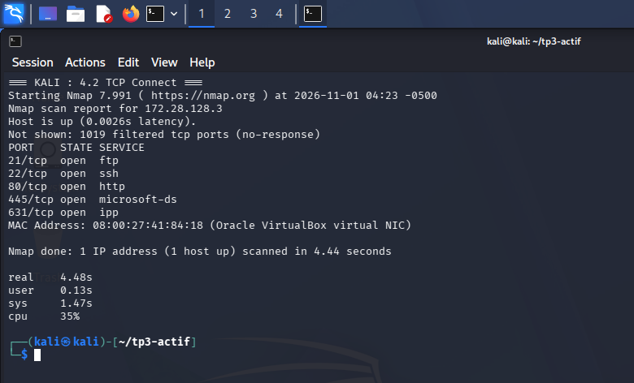</p>
<p align="center"><sub><b>Figure 18</b> — TCP Connect sur les ports 1-1024 : 5 ports ouverts, 4,44 s (real 4,48 s, user 0,13 s).</sub></p>

<p align="center">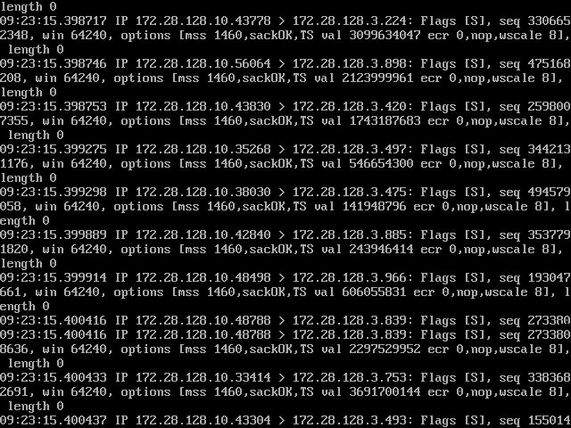</p>
<p align="center"><sub><b>Figure 19</b> — Trafic reçu par la cible pendant le scan TCP Connect : des paquets <code>[S]</code> vers des centaines de ports.</sub></p>

### 🔹 Étape 14 — Scan TCP SYN (`-sS`)

*Objectif : refaire le même balayage avec des paquets SYN seuls (demi-ouverture), qui exige les privilèges `sudo`.*

```bash
# Kali
time sudo nmap -n -sS -p 1-1024 172.28.128.3 -oN tcp/syn.txt
```

<p align="center">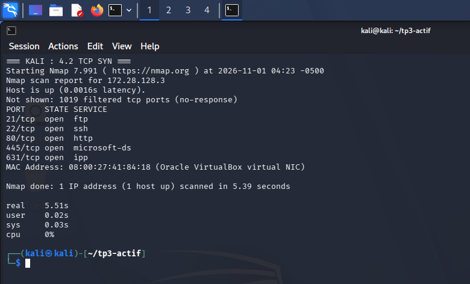</p>
<p align="center"><sub><b>Figure 20</b> — TCP SYN sur les ports 1-1024 : mêmes 5 ports ouverts, 5,39 s (real 5,51 s).</sub></p>

<p align="center">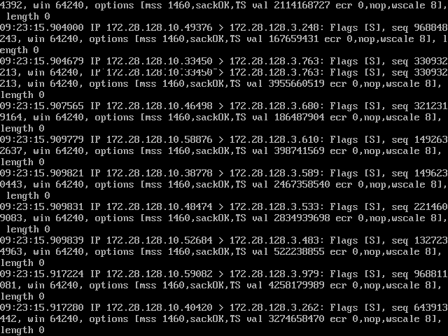</p>
<p align="center"><sub><b>Figure 21</b> — Trafic reçu par la cible pendant le scan SYN : paquets <code>[S]</code> avec fenêtre 1024.</sub></p>

| Critère | TCP Connect | TCP SYN | Conclusion |
|---|---|---|---|
| Connexion complète | Oui : `connect()` termine le 3-way handshake | Non : SYN, puis RST à la réponse SYN/ACK | Le SYN n'ouvre pas de connexion applicative |
| Durée observée | 4,44 s | 5,39 s | Comparables sur un réseau local ; le SYN n'est pas plus rapide ici |
| Privilèges nécessaires | Aucun | Sockets bruts : root ou capacité `CAP_NET_RAW` | Sur Kali, `nmap` a ses capacités (le `setcap` s'est appliqué à l'installation), mais le TP lance `sudo` |
| Traces visibles | 2 085 paquets reçus par la cible | 2 061 paquets reçus par la cible | Quasiment le même volume dans `tcpdump` |
| Ports ouverts trouvés | 21, 22, 80, 445, 631 | 21, 22, 80, 445, 631 | Résultats identiques |

<p class="tcap">**Table 6** — Comparaison des scans TCP (les volumes viennent des mesures de la partie 6)</p>

> 🔎 **Conclusion**
>
> Un scan SYN est parfois qualifié de moins bruyant, car il ne termine pas la connexion et laisse donc moins de traces dans les journaux des applications. Mais il reste **détectable** : `tcpdump` voit le même volume (environ 2 000 paquets pour 1 024 ports) et les mêmes drapeaux `[S]`. Un IDS réseau le repère facilement.

### 7.3. Exercice 4.3 : interpréter les états

| État | Signification | Exemple observé |
|---|---|---|
| `open` | Un service accepte les connexions (réponse SYN/ACK). | 21, 22, 80, 445, 3306 |
| `closed` | La machine répond (RST) mais aucun service n'écoute. | 3000, 8181 |
| `filtered` | Un filtrage empêche Nmap de conclure (aucune réponse). | 23, 25, 139, 5432, 8180 |
| `open\|filtered` | Nmap ne peut pas distinguer ouvert et filtré (typique en UDP). | tous les ports UDP testés (partie 5) |

## 8. Partie 5 — UDP, services et système

### 8.1. Exercice 5.1 : scan UDP ciblé

### 🔹 Étape 15 — Scan UDP des 20 ports les plus courants

*Objectif : tester les services UDP (sans handshake). Nécessite `sudo`.*

```bash
sudo nmap -n -sU --top-ports 20 172.28.128.3 -oN udp/top20.txt
```

<p align="center">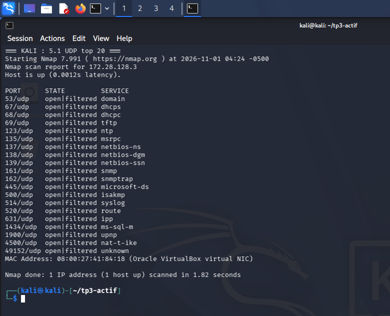</p>
<p align="center"><sub><b>Figure 22</b> — Scan UDP top 20 : les 20 ports sont <code>open|filtered</code>, durée 1,82 s.</sub></p>

### 🔹 Étape 16 — Scan UDP des ports demandés

*Objectif : vérifier 53, 69, 111, 137 et 161.*

```bash
sudo nmap -n -sU -p 53,69,111,137,161 172.28.128.3 -oN udp/ports-cibles.txt
```

<p align="center">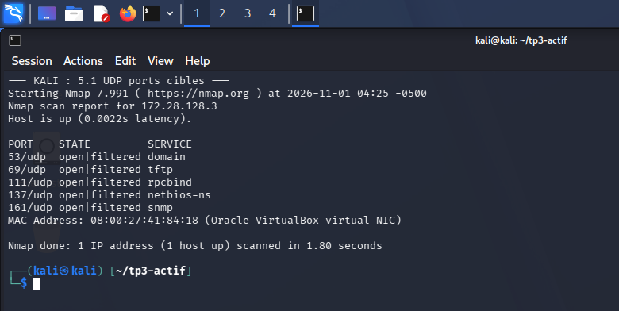</p>
<p align="center"><sub><b>Figure 23</b> — Scan UDP ciblé : les 5 ports sont <code>open|filtered</code>, durée 1,80 s.</sub></p>

**Observation.** Tous les ports UDP testés sont **open|filtered** : la cible ne renvoie ni réponse UDP, ni message ICMP « port unreachable ».
La capture réalisée en 6.2 montre pourtant que Nmap envoie des sondes spécifiques à chaque service (requête SNMP `GetRequest`, lecture TFTP `RRQ "r7tftp.txt"`, requête NetBIOS, BOOTP/DHCP).

> 🔎 **Analyse — questions du TP**
>
> - **Pourquoi le scan UDP est-il généralement plus lent ?** UDP n'a pas de handshake : sans réponse, Nmap doit attendre puis retransmettre, et les messages ICMP « port unreachable » sont limités en débit par les systèmes. Ici il est rapide car peu de ports sont testés et la cible ne répond à rien.
>
> - **Que signifie `open|filtered` ?** Aucun retour : le port peut être ouvert (service silencieux) ou filtré (paquet jeté par un pare-feu).
>
> - **Quels services UDP a-t-on identifiés ?** Aucun avec certitude : les noms affichés (domain, tftp, rpcbind, netbios-ns, snmp) sont déduits des numéros de port et ne sont pas confirmés.

### 8.2. Exercice 5.2 : détection des services et versions

### 🔹 Étape 17 — Détection de versions

*Objectif : identifier le logiciel et sa version derrière chaque port ouvert.*

```bash
nmap -n -sV 172.28.128.3 -oN services/versions.txt
```

<p align="center">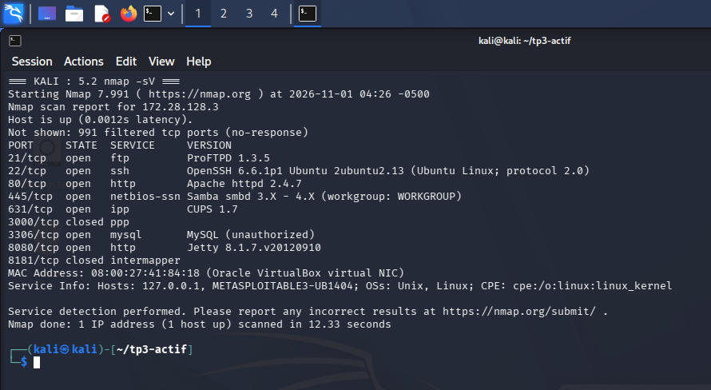</p>
<p align="center"><sub><b>Figure 24</b> — <code>nmap -sV</code> : versions des services, 12,33 s.</sub></p>

```bash
nmap -n -sV --version-light 172.28.128.3 -oN services/versions-light.txt
```

<p align="center">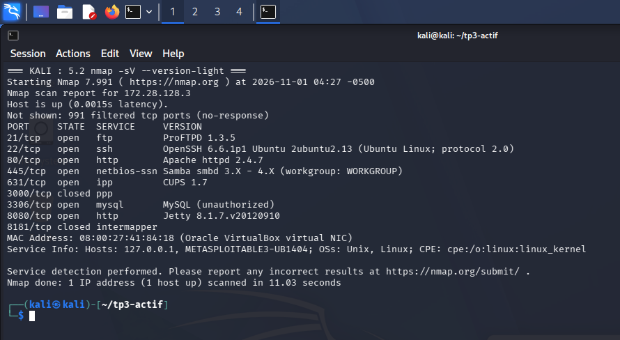</p>
<p align="center"><sub><b>Figure 25</b> — <code>nmap -sV --version-light</code> : même résultat en 11,03 s (sondes moins nombreuses).</sub></p>

| Port | Protocole | Service | Version détectée |
|---|---|---|---|
| 21 | tcp | ftp | ProFTPD 1.3.5 |
| 22 | tcp | ssh | OpenSSH 6.6.1p1 Ubuntu 2ubuntu2.13 (protocole 2.0) |
| 80 | tcp | http | Apache httpd 2.4.7 |
| 445 | tcp | netbios-ssn | Samba smbd 3.X – 4.X (workgroup WORKGROUP) |
| 631 | tcp | ipp | CUPS 1.7 |
| 3306 | tcp | mysql | MySQL (unauthorized) |
| 8080 | tcp | http | Jetty 8.1.7.v20120910 |
| 3000, 8181 | tcp | ppp, intermapper | closed |

<p class="tcap">**Table 7** — Inventaire des services</p>

**Observation.** Nmap relève aussi l'hôte `METASPLOITABLE3-UB1404` et le système « Unix, Linux » (`cpe:/o:linux:linux_kernel`). Ces versions anciennes (ProFTPD 1.3.5, Apache 2.4.7, OpenSSH 6.6.1, Jetty 8.1.7) sont celles qu'un pentester chercherait dans les bases de vulnérabilités ; le TP ne demande aucune exploitation.

### 8.3. Exercice 5.3 : estimation du système d'exploitation

### 🔹 Étape 18 — Détection d'OS

*Objectif : estimer le système d'exploitation à partir de l'empreinte TCP/IP.*

```bash
sudo nmap -n -O 172.28.128.3 -oN services/os.txt
```

<p align="center">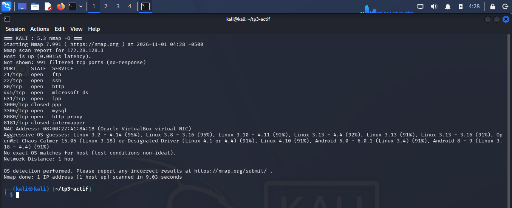</p>
<p align="center"><sub><b>Figure 26</b> — <code>nmap -O</code> : plusieurs hypothèses Linux avec 91–95 % de confiance, aucune correspondance exacte.</sub></p>

```bash
sudo nmap -n -sS -sV -O 172.28.128.3 -oN services/scan-combine.txt
```

<p align="center">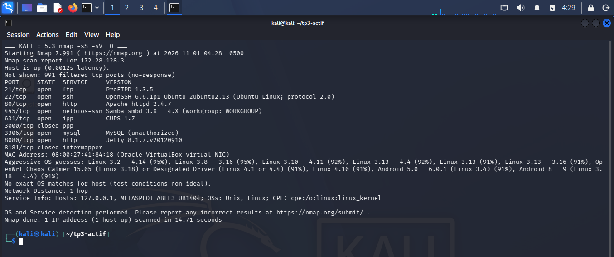</p>
<p align="center"><sub><b>Figure 27</b> — Scan combiné <code>-sS -sV -O</code> : services, versions et OS en 14,71 s.</sub></p>

> 🔎 **Analyse — questions du TP**
>
> - **Quel système d'exploitation Nmap propose-t-il ?** Linux : « Linux 3.2 – 4.14 » (95 %), « Linux 3.8 – 3.16 » (95 %), « Linux 3.10 – 4.11 » (92 %), « Linux 3.13 – 4.4 » (92 %), puis d'autres (OpenWrt, Android). La réalité est Ubuntu 14.04, noyau 3.13, bien inclus dans les hypothèses.
>
> - **Quel niveau de confiance ou quelles variantes ?** Plusieurs variantes entre 91 et 95 % et le message « No exact OS matches for host (test conditions non-ideal) » : Nmap n'a pas de certitude.
>
> - **Pourquoi cette détection reste-t-elle une estimation ?** Nmap compare une empreinte (TTL, fenêtre TCP, options, séquences IP) à une base de signatures. Le filtrage, l'état des ports et la version du noyau modifient l'empreinte, donc plusieurs systèmes se ressemblent.

## 9. Partie 6 — Scripts NSE et détectabilité

### 9.1. Exercice 6.1 : scripts par défaut et scripts sûrs

### 🔹 Étape 19 — Scripts par défaut avec détection de versions

*Objectif : récupérer des informations supplémentaires avec les scripts de la catégorie `default`.*

```bash
nmap -n -sC -sV 172.28.128.3 -oN nse/default.txt
```

<p align="center">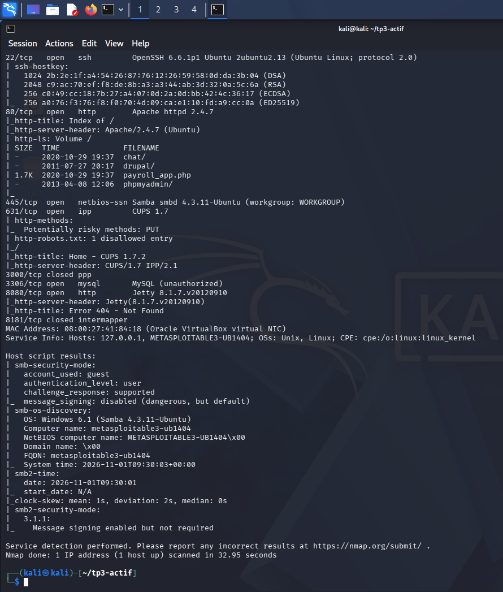</p>
<p align="center"><sub><b>Figure 28</b> — <code>nmap -sC -sV</code> : clés SSH, titre et répertoire HTTP, détails SMB (32,95 s).</sub></p>

**Observation.** Les scripts révèlent : les clés d'hôte SSH (DSA, RSA, ECDSA, ED25519) ; sur le port 80 le titre `Index of /` et un listage (`chat/`, `drupal/`,
`payroll_app.php`, `phpmyadmin/`) ; sur le port 631 (CUPS 1.7.2) la méthode HTTP `PUT` signalée comme potentiellement risquée ; sur SMB le système
`Samba 4.3.11-Ubuntu`, le nom `metasploitable3-ub1404`, un compte invité et la **signature des messages désactivée** (« dangerous, but default »).

### 🔹 Étape 20 — Scripts HTTP ciblés

*Objectif : n'exécuter que deux scripts non intrusifs sur les ports web.*

```bash
nmap -n --script http-title,http-headers -p 80,8180 172.28.128.3 -oN nse/http.txt
```

<p align="center">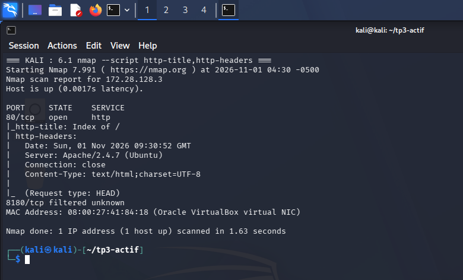</p>
<p align="center"><sub><b>Figure 29</b> — Scripts <code>http-title</code> et <code>http-headers</code> sur les ports 80 (ouvert) et 8180 (filtré), 1,63 s.</sub></p>

**Observation.** Le port 80 répond « Index of / », serveur `Apache/2.4.7 (Ubuntu)` (requête de type HEAD). Le port 8180 reste `filtered`.

### 🔹 Étape 21 — Catégorie de scripts sûrs

*Objectif : exécuter tous les scripts classés `safe`. Le scan est long (plusieurs minutes).*

```bash
nmap -n --script safe 172.28.128.3 -oN nse/safe.txt
```

<p align="center">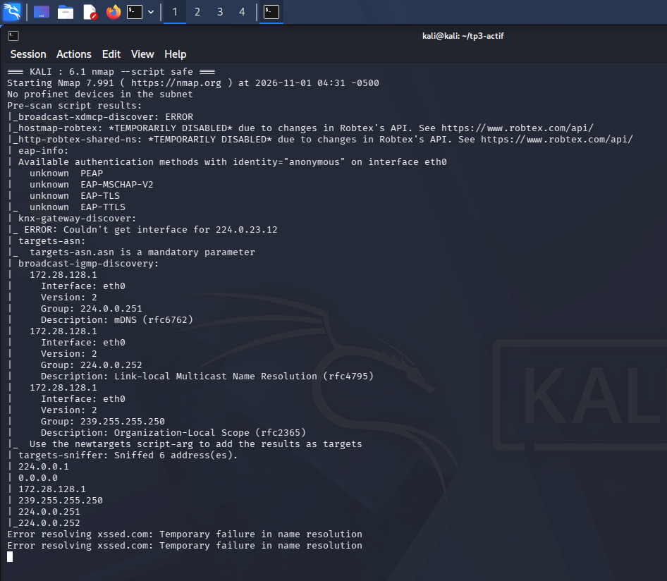</p>
<p align="center"><sub><b>Figure 30</b> — Début du scan <code>--script safe</code> : scripts « pre-scan » (découverte de diffusion, écoute des adresses).</sub></p>

<p align="center"></p>
<p align="center"><sub><b>Figure 31</b> — Pendant le scan : les scripts qui tentent de joindre Internet (<code>xssed.com</code>) échouent, ce qui confirme l'isolement.</sub></p>

<p align="center">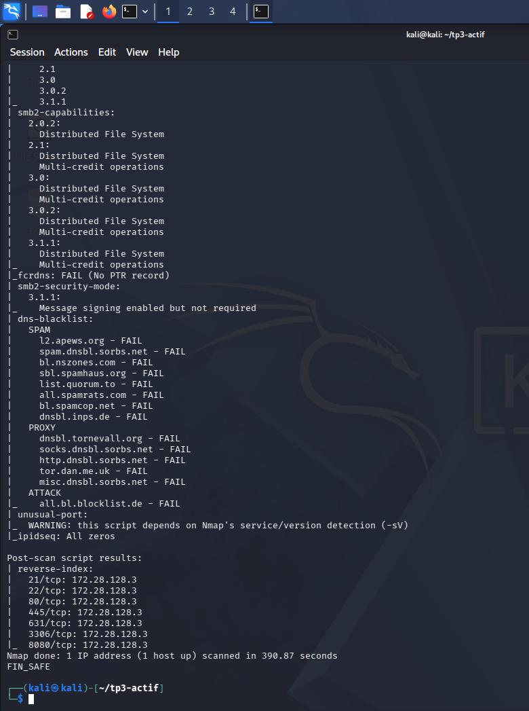</p>
<p align="center"><sub><b>Figure 32</b> — Fin du scan <code>--script safe</code> : durée totale 390,87 s ; résultats SMB et « reverse-index » des services.</sub></p>

**Observation.** Le scan `safe` a duré **390,87 s** (6 min 30). Il lance des scripts avant le scan (écoute du segment, IGMP, EAP), pendant (SMB, énumération NetBIOS, `unusual-port`, `dns-blacklist`, `fcrdns`)
et après (`reverse-index`). Les scripts qui ont besoin d'Internet échouent, car le laboratoire est isolé : `Error resolving xssed.com: Temporary failure in name resolution` et tous les services de `dns-blacklist` en `FAIL`.

> ⚠️ **Attention**
>
> Aucune catégorie `brute`, `exploit` ou `dos` ni script non validé n'a été utilisé, comme l'exige le sujet.

### 9.2. Exercice 6.2 : mesure des traces

Pour chaque technique, une capture est enregistrée sur Metasploitable 3 pendant que Kali lance la commande. Après quelques secondes la capture est arrêtée par `Ctrl+C`,
le nombre de paquets est compté puis un résumé est affiché avec `head -n 30`. Les six techniques sont mesurées dans l'ordre ci-dessous.

```bash
# Metasploitable 3 (une capture par technique)
sudo tcpdump -n -i eth0 host 172.28.128.10 -w /tmp/<technique>.pcap
# ... Ctrl+C après la commande de Kali ...
sudo tcpdump -n -r /tmp/<technique>.pcap | wc -l
sudo tcpdump -n -r /tmp/<technique>.pcap | head -n 30
```

#### 9.2.1. Découverte ARP/ICMP

```bash
# Kali
nmap -n -sn 172.28.128.0/24
```

<p align="center">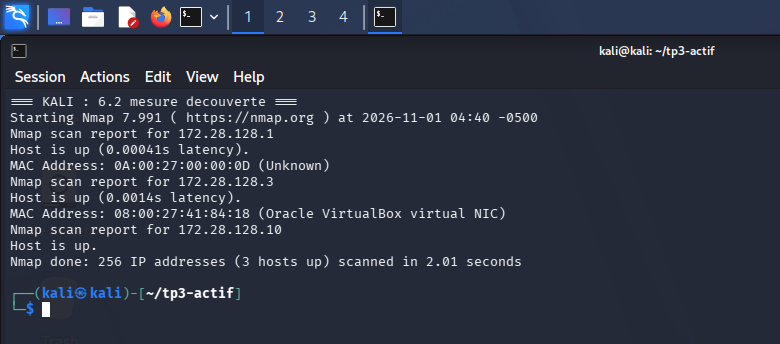</p>
<p align="center"><sub><b>Figure 33</b> — Commande lancée sur Kali — découverte ARP/ICMP.</sub></p>

<p align="center">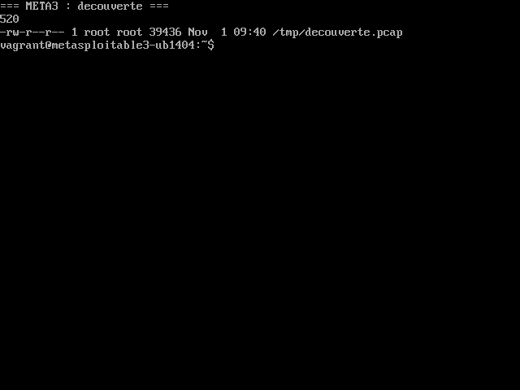</p>
<p align="center"><sub><b>Figure 34</b> — Cible : nombre de paquets et taille de la capture — découverte ARP/ICMP.</sub></p>

<p align="center">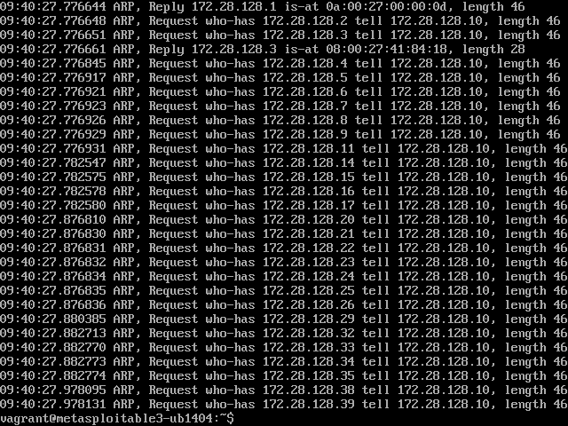</p>
<p align="center"><sub><b>Figure 35</b> — Cible : les 30 premiers paquets (<code>head -n 30</code>) — découverte ARP/ICMP.</sub></p>

**Observation.** **520 paquets** (39 436 octets). Les 30 premiers paquets sont presque tous des requêtes ARP `who-has 172.28.128.x tell 172.28.128.10` adressées à des adresses consécutives (.2, .3, .4 …) : un balayage séquentiel facile à reconnaître. Seules les adresses .1 et .3 répondent.

#### 9.2.2. TCP Connect

```bash
# Kali
nmap -n -sT -p 1-1024 172.28.128.3
```

<p align="center">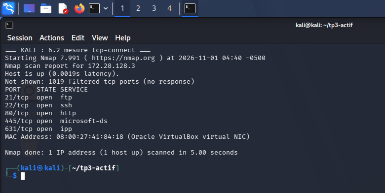</p>
<p align="center"><sub><b>Figure 36</b> — Commande lancée sur Kali — TCP Connect.</sub></p>

<p align="center">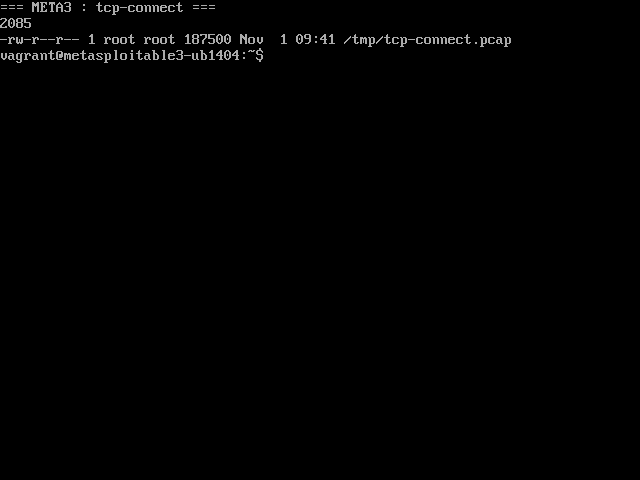</p>
<p align="center"><sub><b>Figure 37</b> — Cible : nombre de paquets et taille de la capture — TCP Connect.</sub></p>

<p align="center">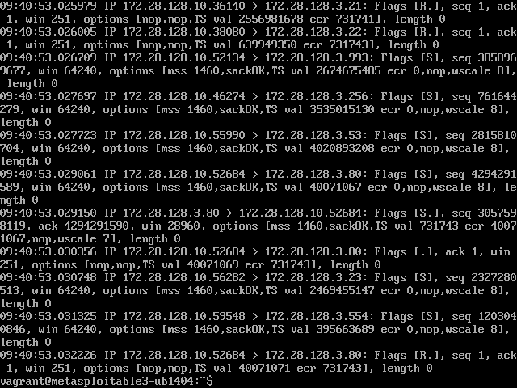</p>
<p align="center"><sub><b>Figure 38</b> — Cible : les 30 premiers paquets (<code>head -n 30</code>) — TCP Connect.</sub></p>

**Observation.** **2 085 paquets** (187 500 octets). Chaque port reçoit un `[S]` avec options complètes (`mss 1460, sackOK, TS, wscale 8`) ; les ports ouverts reçoivent un handshake complet puis une fermeture, d'où le volume légèrement supérieur au SYN.

#### 9.2.3. TCP SYN

```bash
# Kali
sudo nmap -n -sS -p 1-1024 172.28.128.3
```

<p align="center">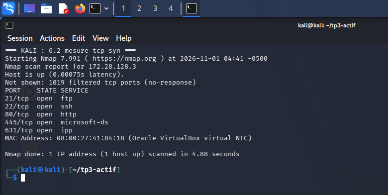</p>
<p align="center"><sub><b>Figure 39</b> — Commande lancée sur Kali — TCP SYN.</sub></p>

<p align="center">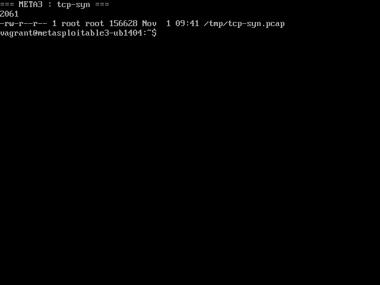</p>
<p align="center"><sub><b>Figure 40</b> — Cible : nombre de paquets et taille de la capture — TCP SYN.</sub></p>

<p align="center">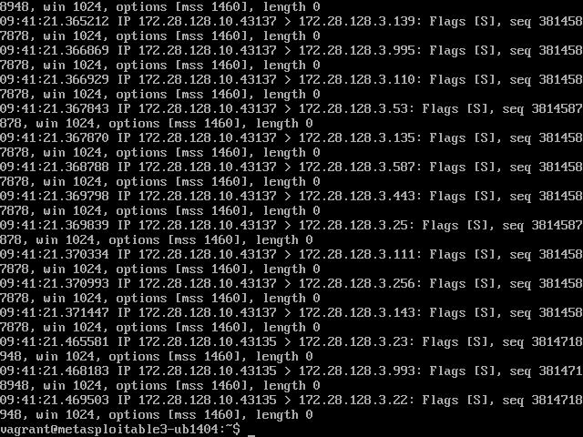</p>
<p align="center"><sub><b>Figure 41</b> — Cible : les 30 premiers paquets (<code>head -n 30</code>) — TCP SYN.</sub></p>

**Observation.** **2 061 paquets** (156 628 octets). Les paquets `[S]` ont une fenêtre de 1024 et l'option `mss 1460` seule (empreinte caractéristique de Nmap en SYN). Les ports sont parcourus dans un ordre mélangé.

#### 9.2.4. UDP ciblé

```bash
# Kali
sudo nmap -n -sU --top-ports 20 172.28.128.3
```

<p align="center"></p>
<p align="center"><sub><b>Figure 42</b> — Commande lancée sur Kali — UDP top 20.</sub></p>

<p align="center">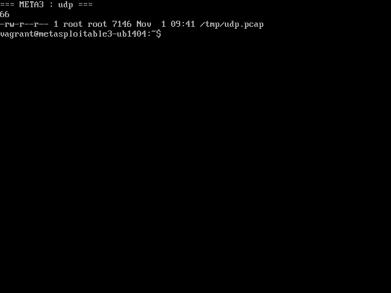</p>
<p align="center"><sub><b>Figure 43</b> — Cible : nombre de paquets et taille de la capture — UDP top 20.</sub></p>

<p align="center">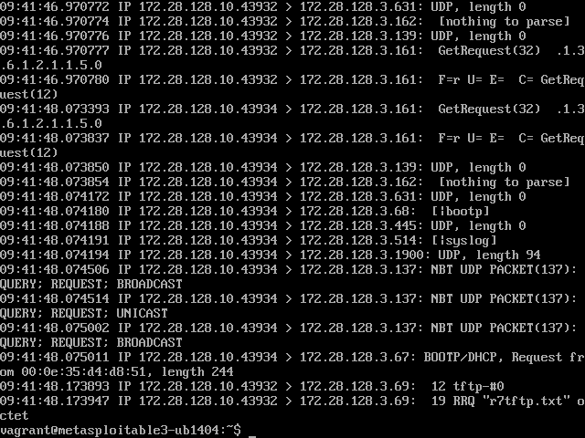</p>
<p align="center"><sub><b>Figure 44</b> — Cible : les 30 premiers paquets (<code>head -n 30</code>) — UDP top 20.</sub></p>

**Observation.** **66 paquets** (7 146 octets), le volume le plus faible. Les sondes sont spécifiques aux services : `GetRequest` SNMP, `RRQ "r7tftp.txt"` TFTP, requêtes NBT, BOOTP/DHCP. Sans réponse de la cible, Nmap renvoie les sondes une seconde fois.

#### 9.2.5. Détection de versions (-sV)

```bash
# Kali
nmap -n -sV 172.28.128.3
```

<p align="center"></p>
<p align="center"><sub><b>Figure 45</b> — Commande lancée sur Kali — détection de versions.</sub></p>

<p align="center">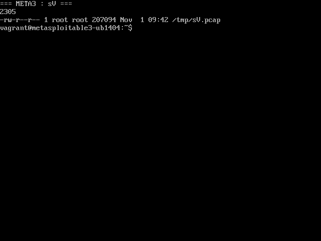</p>
<p align="center"><sub><b>Figure 46</b> — Cible : nombre de paquets et taille de la capture — détection de versions.</sub></p>

<p align="center">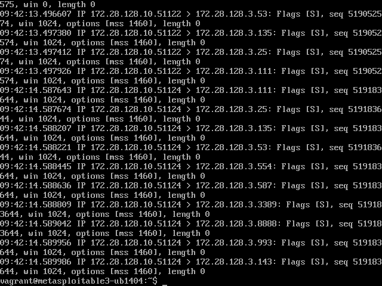</p>
<p align="center"><sub><b>Figure 47</b> — Cible : les 30 premiers paquets (<code>head -n 30</code>) — détection de versions.</sub></p>

**Observation.** **2 305 paquets** (207 094 octets). Au scan SYN s'ajoutent des connexions complètes aux ports ouverts pour lire les bannières et envoyer des sondes applicatives.

#### 9.2.6. NSE safe

```bash
# Kali
nmap -n --script safe 172.28.128.3; echo FIN_SAFE
```

<p align="center">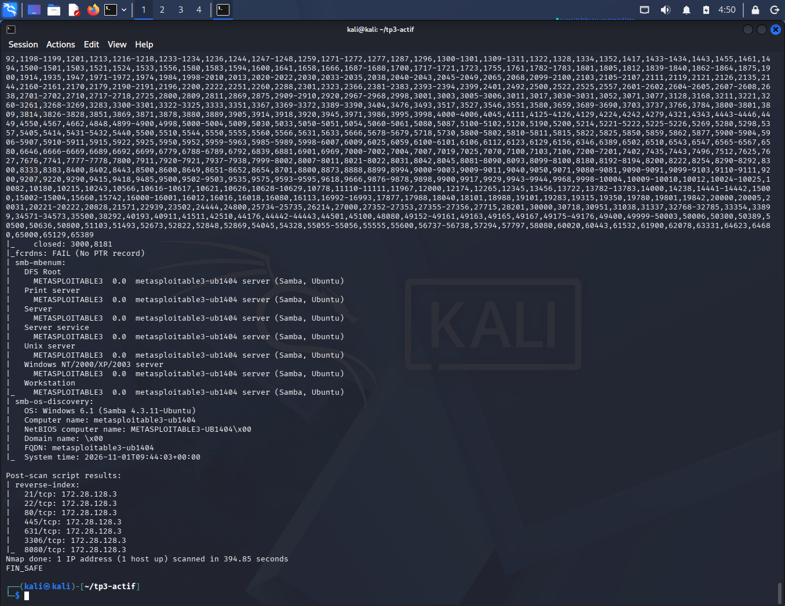</p>
<p align="center"><sub><b>Figure 48</b> — Commande lancée sur Kali — NSE safe.</sub></p>

<p align="center"></p>
<p align="center"><sub><b>Figure 49</b> — Cible : nombre de paquets et taille de la capture — NSE safe.</sub></p>

<p align="center">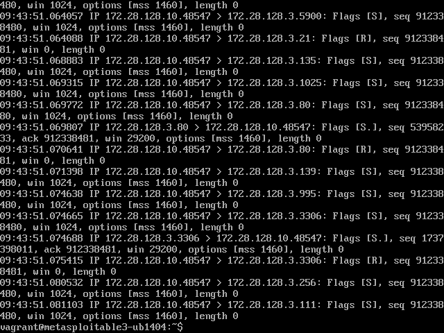</p>
<p align="center"><sub><b>Figure 50</b> — Cible : les 30 premiers paquets (<code>head -n 30</code>) — NSE safe.</sub></p>

**Observation.** **36 323 paquets** (14 283 314 octets, environ 14,3 Mo) en 394,85 s : de loin le plus volumineux, avec requêtes HTTP, SMB, FTP, SSH, DNS et de nombreuses sondes.

| Technique | Traces observées | Volume relatif | Détectabilité |
|---|---|---|---|
| Découverte ARP/ICMP | Requêtes ARP broadcast vers 254 adresses consécutives, réponses des hôtes actifs | 520 paquets (faible) | Faible à moyenne : ARP est normal, mais le balayage séquentiel est caractéristique |
| TCP Connect | SYN vers 1 024 ports, SYN/ACK ou RST, handshake complet sur les ports ouverts | 2 085 paquets | Élevée : connexions complètes, visibles dans les journaux des services |
| TCP SYN | SYN (fenêtre 1024, mss 1460) vers 1 024 ports, RST sur les ports ouverts | 2 061 paquets | Élevée au niveau réseau (IDS), plus faible dans les journaux applicatifs |
| UDP ciblé | 20 datagrammes de sondes de service, aucune réponse | 66 paquets (très faible) | Faible en volume, mais les sondes SNMP/TFTP sont reconnues par un IDS |
| Détection -sV | Connexions complètes aux ports ouverts, bannières, sondes applicatives | 2 305 paquets | Élevée : échanges applicatifs qui laissent des traces dans les services |
| NSE safe | Requêtes HTTP, SMB, FTP, SSH, DNS, sondes multiples sur 6 min 30 | 36 323 paquets (14,3 Mo) | Très élevée : volumineux, long, nombreux protocoles |

<p class="tcap">**Table 8** — Comparaison de la détectabilité (volumes mesurés sur la cible)</p>

## 10. Analyse de la traçabilité

> 🔎 **Réponses aux questions du sujet**
>
> - **Quelle information identifie Kali sur le segment local ?** Son adresse MAC (couche 2) et son adresse IP, visibles dans `tcpdump -e` et `arp -n` de la cible (08:00:27:47:7f:19 / 172.28.128.10 au départ, puis 1e:25:20:be:5f:c7 après randomisation).
>
> - **Quelle information serait principalement enregistrée par une cible distante ?** L'adresse IP source, ainsi que le comportement (ports sondés, bannières, horodatage). La MAC n'est pas transmise au-delà du routeur.
>
> - **Pourquoi changer la MAC ne masque-t-il pas l'adresse IP ?** La MAC n'agit que sur la couche 2 locale. L'IP (couche 3) reste la même, comme vu en 5.2 (172.28.128.10 inchangée).
>
> - **Pourquoi l'usurpation simple d'une IP ne permet-elle généralement pas de recevoir les réponses TCP ?** Les réponses (SYN/ACK) sont envoyées à l'adresse usurpée, pas à l'attaquant. Sans être sur le chemin ou sans capture réseau, il ne peut pas terminer le handshake.
>
> - **Pourquoi un VPN ou un relais ne garantit-il pas un anonymat absolu ?** L'opérateur du VPN ou du relais voit le trafic et peut le journaliser ou le livrer sur demande ; les corrélations de trafic, les fuites DNS et les empreintes de la machine peuvent aussi identifier l'utilisateur.
>
> - **Quelle approche doit être retenue dans un pentest professionnel ?** Une machine et une adresse IP dédiées, autorisées et journalisées, dans un périmètre écrit. La traçabilité est contrôlée ; elle n'est pas illégalement supprimée.

## 11. Difficultés rencontrées et solutions

| Difficulté | Cause | Solution |
|---|---|---|
| Plantage de Nmap (`massdns.cc … Assertion failed`) | Résolution DNS inverse impossible sans réseau | Option `-n` sur toutes les commandes `nmap` |
| Ping impossible après `macchanger -r` | La carte virtuelle VirtualBox filtre les trames vers une MAC non déclarée | Mode promiscuité (`ip link set eth0 promisc on`) et politique « Allow All » sur la carte Host-Only |
| IP perdue après `ip link set eth0 down/up` | NetworkManager efface l'adresse posée à la main | Profil permanent `lab-hostonly` et `nmcli connection up lab-hostonly` |
| Pas d'IP sur Metasploitable après redémarrage | Réseau Host-Only sans DHCP | `sudo ip addr add 172.28.128.3/24 dev eth0` |
| Installation des outils sans Internet | NAT retiré pour respecter l'isolement | Carte NAT rebranchée temporairement sur Kali, puis retirée avant les scans |
| Démarrage de Kali refusé (erreur 1455) | Mémoire de l'hôte insuffisante pour 4 Go | RAM de Kali ramenée à 2 Go |
| Clavier de Kali bloqué (touches modificatrices) | État du clavier de la fenêtre VM incohérent | Redémarrage de la VM ; saisie fiabilisée depuis l'hôte |

## 12. Limites et réserves

- Le scan UDP n'a confirmé aucun service : tous les ports sont restés `open|filtered`.

- Les durées mesurées dépendent de la charge de l'hôte et de la machine virtuelle ; elles servent de comparaison, non de référence absolue.

- La détection d'OS reste une estimation (aucune correspondance exacte).

- Les volumes de la Table 8 viennent d'une exécution unique par technique ; les deux scans TCP donnent des valeurs très proches (2 085 et 2 061 paquets).

- Les adresses IP ne sont pas persistantes côté Metasploitable 3.

## 13. Conclusion générale

Le TP a permis de configurer un laboratoire isolé, d'identifier les adresses IP et MAC des deux machines, puis de montrer que la **MAC est une identité locale
modifiable** alors que l'**IP reste l'identité observée** dans une communication distante. La découverte d'hôtes (Nmap, ARP-Scan, Netdiscover) a trouvé la cible
`172.28.128.3`. Les scans TCP ont révélé sept services ouverts (FTP, SSH, HTTP, SMB, CUPS, MySQL, Jetty) dont les versions anciennes ont été relevées.

La mesure des traces montre qu'aucune technique n'est invisible : le scan SYN, parfois dit « discret », produit autant de paquets qu'un scan TCP Connect (environ 2 000 pour 1 024 ports),
tandis que les scripts NSE `safe` génèrent plus de 36 000 paquets en plus de six minutes. Un pentest professionnel doit donc s'effectuer depuis une machine et une adresse IP
dédiées, autorisées et journalisées : la traçabilité est contrôlée, pas supprimée.

## Annexe — Livrables et archive

Le dossier `~/tp3-actif` de Kali est archivé comme demandé par le sujet. L'archive contient : le journal horodaté et l'historique des commandes, la comparaison de la MAC avant/après,
les résultats de découverte (Nmap, ARP-Scan, Netdiscover), les résultats TCP et UDP, l'inventaire des services et les sorties NSE.

```bash
cd ~/tp3-actif
fc -l 1 > rapport/historique-commandes.txt
date -Iseconds | tee -a rapport/journal.txt
cd ~
zip -r TP3_BABBA_OMAR.zip tp3-actif/
ls -l TP3_BABBA_OMAR.zip
unzip -l TP3_BABBA_OMAR.zip | tail -n 25
```

<p align="center">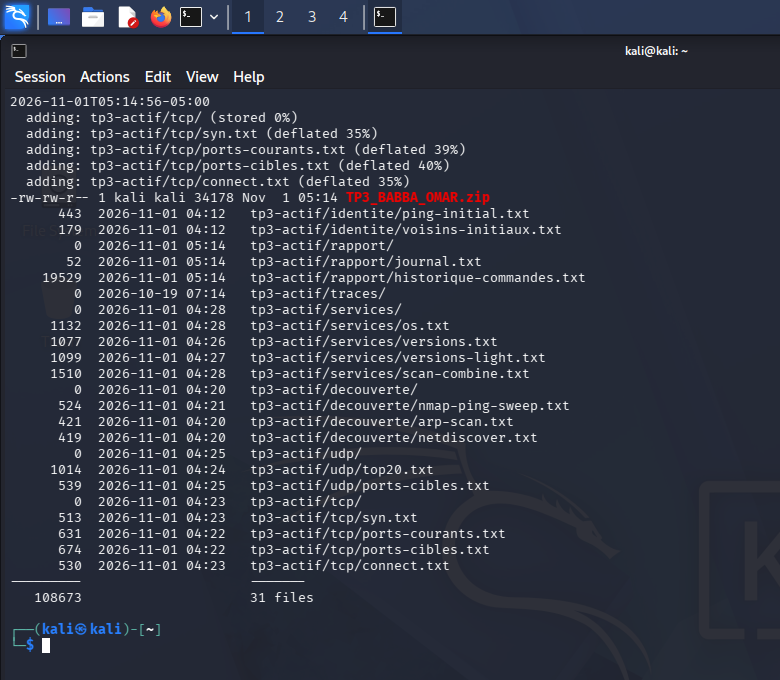</p>
<p align="center"><sub><b>Figure 51</b> — Archive <code>TP3_BABBA_OMAR.zip</code> : 34 178 octets, 31 fichiers.</sub></p>
